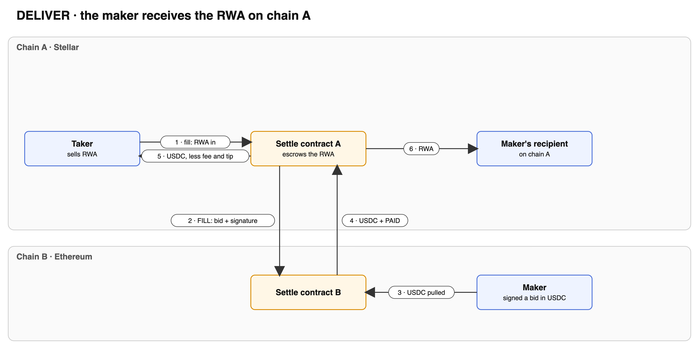
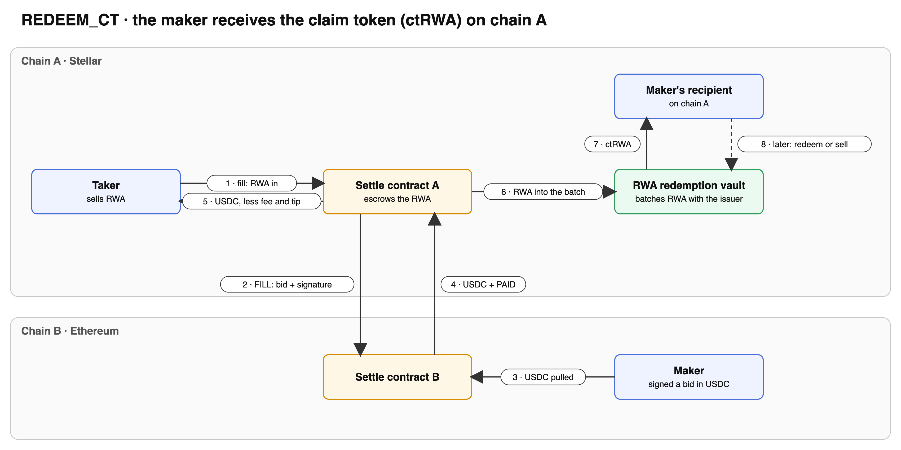
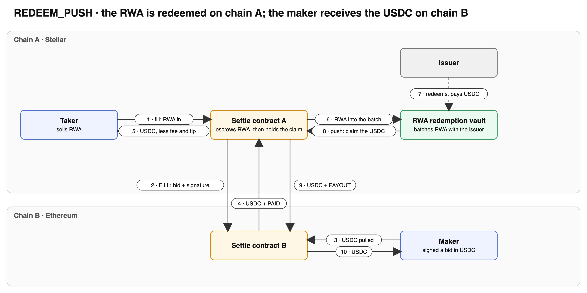
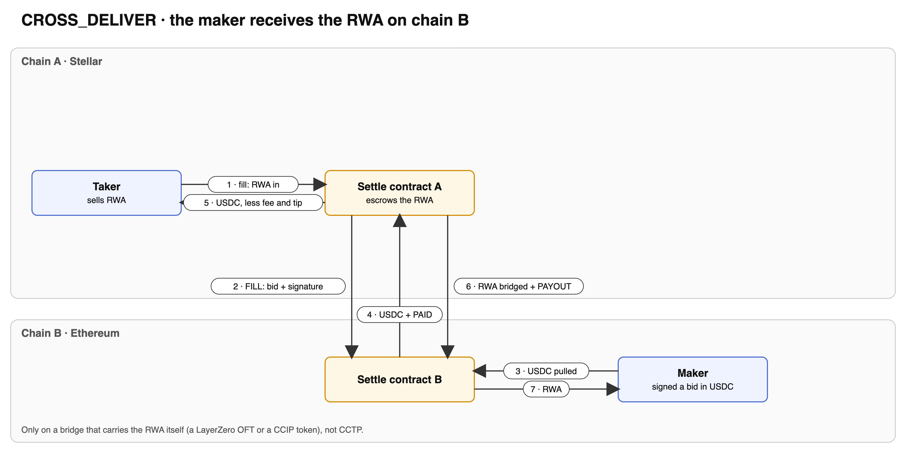

# Cross-chain settlement: RFQ fills between Stellar and EVM chains

A taker sells an RWA on one chain. A market maker (LP) bids for it from another
chain. The taker accepts the bid with **one call, `fill`**, the same UX as a
local RFQ fill. Everything after is delivered by the transports. Nobody,
including us, submits transactions on anyone's behalf, and the LP never acts
on-chain for a fill.

The RWA stays on the taker's chain, except in CROSS_DELIVER, which bridges it
to the maker once the payment has settled.

## Flow

```
taker's chain                                   maker's chain
─────────────                                   ─────────────
fill(request, chain, bid, makerSignature)
  price at the maker's rate (local RFQ)
  escrow the RWA
  send FILL ───────── message ─────────────────▶ on FILL (executor-delivered)
                                                  check the maker's signature
                                                  pull the amount (standing approval)
  on PAID ◀───── stable + PAID ──────────────────  bridge it back with PAID
    pay the taker and the fee                     …or, on any failure:
    deliver the RWA by mode               ◀──────  send FAIL
  on FAIL: return the RWA to the taker
```

- **Pricing is fixed at `fill`.** The taker chain's RFQ contract quotes the
  request at the maker's rate (oracle, redemption schedule, rate ceilings,
  `minReceivedAmount`, the maker's cap). The maker chain pulls exactly that
  amount, so there is no change to return.
- **Fees.** The taker pays every transport fee at `fill`, in its chain's native
  token: the outbound message plus a flat per-chain `returnFee`. The maker
  chain's contract pays the return leg from its own native balance, and admin
  rebalances those balances with `sweep`. Excess `msg.value` is refunded.
- **The id of a fill** is the taker's request hash. Each request has at most
  one fill in flight. A FAIL frees the request, so it can be filled again.

## Routes and contracts

One settle contract per bridge, the same on every chain it runs on. A fill's
messages and its payment use the same bridge, so off-chain picks the contract
from the token and the two chains.

| Contract (EVM / Stellar) | Messages | Payment back | Tokens and chains |
|---|---|---|---|
| `CctpSettle` / `cctp_settle` | CCTP V2 messages | CCTP V2 burn with PAID in the hook. Anyone `complete`s it for the flat tip | Any token CCTP links, between any CCTP domains, EVM ↔ EVM included |
| `LzSettle` / `lz_settle` | LayerZero | OFT send composing PAID (`lzCompose` / `lz_compose`) | Each token with a registered OFT (USDT0; an RWA's OFT for CROSS_DELIVER), between LayerZero chains |
| `CcipSettle` / n/a | CCIP | CCIP token transfer carrying PAID: any stable the lane carries | EVM ↔ EVM |

| Code | Path |
|---|---|
| Shared EVM core (fill, pay-or-fail, settle, cancel, delivery) | `octarine-v2/src/octarine-rfq/crosschain/CrossChainSettle.sol`, interface `interfaces/ICrossChainSettle.sol` |
| CCIP transport | `octarine-v2/src/octarine-rfq/crosschain/CcipSettle.sol` |
| LayerZero + OFT transport | `octarine-v2/src/octarine-rfq/crosschain/LzSettle.sol` |
| CCTP transport | `octarine-v2/src/octarine-rfq/crosschain/CctpSettle.sol` |
| Stellar | `stellar-rfq/contracts/crosschain_settle`: one crate, its transport chosen at build time. `lz.rs` builds `lz_settle.wasm` (default), `cctp.rs` builds `cctp_settle.wasm` (feature `cctp`); `wire.rs` messages. `scripts/01-build.sh` builds both |
| Stellar signature check | `stellar-rfq/contracts/verifier` (see Security) |
| REDEEM modes | `OctarineRedemptionVault` on EVM; `redemption_vault` on Stellar, one per RWA (see `docs/REDEMPTION_VAULT.md`) |

A chain runs each contract whose bridge it trades over. LPs approve each one
they bid through.

Chain ids are each contract's own namespace: CCTP domains in `CctpSettle` and
`cctp_settle`, LayerZero EIDs in `LzSettle` and `lz_settle`, CCIP chain
selectors in `CcipSettle`. The bid hash includes `takerChain` in that
namespace, so a bid is bound to one contract, one taker chain and one request.

### Fail early

- **On the taker's chain**, `fill` checks the following and reverts if any fails:
  - the request is the caller's and is meant for this contract (`sender`), unexpired and unfilled;
  - the bid is unexpired and names a recipient;
  - `(chain, request stable)` is an open **route** and maps to the bid's stable;
  - for CROSS_DELIVER, `(chain, RWA)` is an open route, so the bridge carries
    the RWA, and its OFT quotes the send (on Stellar, LayerZero only);
  - a redemption vault exists for the RWA in REDEEM modes. For REDEEM_PUSH it
    must pay out in the fill's stable, which is what `push` bridges (Stellar
    today; EVM to follow);
  - the quote is within the bid's cap and, after the fee and any tip, the
    taker's minimum.

  Routes are admin-set. On Stellar a route opens only where its bridge carries
  the pair: `cctp_settle` asks the TokenMessengerMinter that CCTP links the
  local and remote tokens; `lz_settle` takes only a token with an OFT in its
  config (`bridge.ofts`, token to OFT).
- **On the maker's chain**, `pay` also checks the following. Any failure sends FAIL:
  - the route back is open;
  - the bid is unused, unexpired and its salt is not cancelled;
  - the amount is within the cap;
  - the signature is valid;
  - the pull succeeds;
  - the bridge accepts the transfer.

  The live CCIP OnRamp (2.0.0) reverts `getFee` for a token with no pool on
  the lane, so an unsupported stable fails here rather than in flight.

## Delivery modes

| Mode | What happens to the RWA on the taker's chain |
|---|---|
| `DELIVER` (0) | Sent to the bid's `recipient`. If it cannot receive (allowlist, trustline), it is owed to them for `withdraw`. |
| `REDEEM_CT` (1) | Redeemed with the issuer through the redemption vault. `recipient` receives the batch's claim token, which it can hold or sell. If the CT's gate refuses it, the CT is owed to it for `withdraw`. A gated vault must admit the settle contract. |
| `REDEEM_PUSH` (2) | Redeemed. This contract holds the claim token. Once the issuer pays, anyone calls `push(id)` (paying the bridge) and the proceeds go to the maker on its chain as PAYOUT. Any RWA the issuer hands back goes to `recipient`. |
| `CROSS_DELIVER` (3) | Bridged to the maker on its chain as PAYOUT, in the same transaction that settles PAID; the maker chain's contract forwards it. LayerZero only (an OFT for the RWA, and a route for it); CCTP carries no RWA, so `fill` refuses it there (`NoRoute`), whatever the routes say. The taker prepays the RWA's bridge fee at `fill`. If the bridge fails, the whole settlement reverts and stays retryable; the RWA is never stranded. `recipient` is unused and may be zero. |

| | |
|---|---|
|  |  |
|  |  |

**Operating CROSS_DELIVER.** Before opening an RWA for it:

1. **Gas for the extra send.** Settlement now also bridges the RWA, inside the PAID delivery. The
   maker chain's options for the PAID leg (LayerZero compose gas, CCIP `gasLimit`) need headroom
   for that second send, or every delivery reverts until it is retried with more gas.
2. **The RWA's OFT on both chains.** The maker's side only accepts a compose from an OFT it has
   registered (`setOft` on EVM, `bridge.ofts` in the timelocked Config on Stellar), so register it
   on both, or the arrival reverts (retryable) until it is.
3. **Mint/burn OFTs only on Stellar.** `lz_settle` authorises only the OFT's burn and the endpoint
   fee, as USDT0 needs. A lock/unlock adapter also needs a `transfer` authorised; until that is
   added, settlement through one would revert on every retry.
4. **Dust.** `fill` quotes the exact send, so an OFT that rejects amounts below its shared decimals
   in its quote (LayerZero's EVM `OFTCore` does) refuses a dusty amount at fill. This is not yet
   verified on Stellar's OFT; until it is, takers should size the RWA to the OFT's shared decimals.
5. **An RWA route is also a payment route.** Routes do not distinguish stables, so routing an RWA
   lets it be named as the paying token of a bid too. That still needs a matching route on the
   other chain and the maker's signature, so it is not exploitable, but open RWA routes knowingly.

`CctpSettle` and `cctp_settle` refuse CROSS_DELIVER at `fill` (`NoRoute`) whatever the routes
say: CCTP burns only Circle's tokens. The bid's `recipient` is unused in this mode and may be zero.

## Functions

| | EVM (`CcipSettle` / `LzSettle` / `CctpSettle`) | Stellar (`lz_settle` / `cctp_settle`) |
|---|---|---|
| Taker accepts a bid | `fill(request, chain, bid, signature)` payable | `fill(request, chain, bid, signature)`, taker-authorised, XLM pulled |
| Fee quote | `fillFee(chain)` | `fill_fee(chain)` |
| Maker's signing hash | `hashBid(requestHash, takerChain, bid)`: EIP-712 | `hash_bid(request_hash, taker_chain, bid)`: sha256 of the request hash, chain word and bid words; signed SEP-53 |
| Message in | `ccipReceive` / `lzReceive` / `handleReceiveFinalizedMessage` (via `MessageTransmitter.receiveMessage`) | `lz_receive` / `handle_recv_finalized_message` (via `MessageTransmitter.receive_message`), then `execute(message)` for a FILL |
| Payment in | `ccipReceive` / `lzCompose` / `complete(message, attestation)` | `lz_compose` / `complete(caller, message, attestation)` |
| REDEEM_PUSH proceeds | `push(id)` payable | `push(caller, id)` |
| Owed tokens | `withdraw(token)` | `withdraw(recipient, token)` |
| Admin | `setPeer(chain, addr, returnFee, args)`, `setRoute`, `setRedemptionVault`, `sweep`, pause; `LzSettle`: `setOft` | Timelocked: `submit(Change)`, then `accept(kind)` by anyone after the delay, or `revoke(kind, caller)` by the guardian or admin. Changes are `Config` (on `lz_settle` its `bridge.ofts` maps each token to its OFT), `Peer(chain, Peer{addr, return_fee, options})`, `Route(chain, stable, remote)`, `Vault(rwa, vault)` and `Delay`. `kind_of(change)` gives the slot; different peers, routes and vaults queue independently. `sweep` stays immediate. |

Makers delegate signing and cancel salts on their chain's RFQ contract.
- **EVM:** `OctarineRFQ.registerAllowedOrderSigner` and `cancelSalt`. Signatures are ECDSA, EIP-1271, or from a registered key.
- **Stellar:** `rfq.register_order_signer` and `cancel_salt`. The signature is the signer's key followed by its ed25519 signature (96 bytes).

## Security

- **Authentication of what arrives:**
  - **CCIP:** the router is the caller, and the source sender is the peer. The contract declares `IAny2EVMMessageReceiver` via ERC-165, without which CCIP would deliver the tokens but never call it.
  - **LayerZero on EVM:** the endpoint is the caller, and `origin.sender` is the peer.
  - **LayerZero on Stellar:** the executor calls the contract directly. The contract requires the executor's auth, checks the peer, and calls `endpoint.clear`, which matches the payload hash the DVNs verified.
  - **OFT payments (USDT0, an RWA):** the compose comes from an OFT in our config and is credited as that OFT's token, and the compose's source sender is the peer.
  - **CCTP messages:** the MessageTransmitter calls the handler, which requires its auth (it is the direct invoker) and that the sender is the peer for the source domain. The transmitter checks the attestation and the nonce. Only finalized messages (2000) are accepted; the unfinalized handler does not exist.
  - **CCTP burns:** the burner (`messageSender`) is the peer for the source domain. `destinationCaller` is set to the peer, so only its `complete` can receive the burn, and the hook always runs. `complete` takes only a message the TokenMessengerMinter receives: any contract can send a plain message for us to receive whose bytes at 248 read like the peer.
- **A bad maker signature must FAIL, not stall.** Stalling would leave the taker's RWA escrowed.
  - **EVM:** all of `pay` runs in a self-call inside `try`. `_onFill` first requires `PAY_GAS` (500k) of gas, so a caller who starves the delivery reverts it, retryable, instead of forcing a FAIL.
  - **Stellar:** `ed25519_verify` traps, and a contract cannot catch its own trap. The check is a `try_` call into the separate `verifier` contract, so a bad signature returns an error and becomes FAIL.
- **Delivery failures retry.** A delivery that reverts on the taker's chain stays retryable: CCIP manual execution, a LayerZero retry, or calling `complete` again. Examples are a paused vault or a recipient that cannot receive yet. Transfers to recipients that cannot receive become `owed` balances, so a blocked recipient never blocks a fill.
- **No timeout refund on the taker's chain**, by design. Every leg is delivered or retryable, and a timeout would race a payment already in flight: the taker would get the RWA back while the maker's money arrives.
- **CROSS_DELIVER bridges the RWA inside the settlement.** A failed OFT send
  (fee drift past our XLM balance, a paused OFT) reverts the whole compose,
  which LayerZero retries. An RWA OFT must burn from us, as USDT0's does: only
  the burn and the endpoint fee are authorised. `fill` quotes the same send
  (amount, minimum, payload), so an OFT whose quote rejects the amount (dust
  below its shared decimals, as LayerZero's OFTs check) refuses it there.
- **A payment must cover the quote.** PAID settles only if the stable that
  arrived is at least the quoted amount (`Underpaid` otherwise; the RWA stays
  escrowed). A compromised peer cannot release the RWA for dust.
- **Governance is timelocked on Stellar.** These changes wait out the delay:
  - **config**, which includes the signature verifier;
  - **peers**;
  - **routes**;
  - **redemption vaults.**

  Each of them could otherwise redirect funds: a fake verifier would pass any
  signature, a fake peer could forge PAID, and a fake vault would receive the
  RWA. The EVM contracts get the same treatment next.
- **Replay.** The maker's chain marks each bid hash used. The taker's chain deletes the order when it settles or cancels. CCTP nonces and LayerZero payload clearing stop re-delivery; on Stellar `execute` takes a received FILL once.

## Relaying CCTP

CCTP has no executor. Messages are sent with `destinationCaller` 0 and
finality 2000, so anyone holding the attestation relays them. Iris serves it:
`GET /v2/messages/{sourceDomain}?transactionHash=…` (sandbox:
`iris-api-sandbox.circle.com`).

- **FILL** is relayed on the maker's chain by the maker's keeper.
- **FAIL** is relayed on the taker's chain by the taker.
- **PAID and PAYOUT** ride burns. Anyone `complete`s them, for the flat tip.

Relayers call the real `MessageTransmitter.receive_message` directly, which
calls our handler: Soroban forbids re-entering a contract already on the call
stack, so our contract cannot be the caller. The EVM side does the same, for
symmetry. For the same reason a FILL on Stellar waits in the handler: its reply
(the burn, or FAIL) goes through the transmitter, which is still on the stack.
Anyone then calls `execute(message)` to pay or fail it, which the keeper does
next.

## Fees and the tip

- **`fill_fee(chain)`** is what `fill` charges the taker in native token: the
  outbound FILL (quoted with a 96-byte signature) plus the peer's flat
  `returnFee`. CCTP messages and burns are free, so on `CctpSettle` and
  `cctp_settle` it is the return fee alone.
- **CROSS_DELIVER** adds the RWA's OFT `quote_send` native fee, taken at `fill`
  (simulate `fill` to see it). The contract pays the send at settlement from
  its balance, which absorbs any drift.
- **The return leg** is paid by the maker chain's contract from its native
  balance: an OFT send, a CCIP transfer, or a FAIL message. Admin rebalances
  with `sweep`. LayerZero on Stellar takes its fee as XLM transferred to the
  endpoint before `send`.
- **The tip** is flat, in wire units (6 decimals), set in `Config` behind the
  timelock, and charged to every payment's recipient. It pays whoever
  `complete`s the delivery; when an executor delivers (LayerZero), it goes back
  to the recipient. `lz_settle` deployments set it to 0.
  - **PAID:** the taker gets `amount − fee − tip`. `fill` checks the taker's
    minimum after the tip.
  - **PAYOUT:** the tip comes out of the payout.
  - **The taker can complete it themselves and keep the tip.**
- **On EVM, `complete` still pays `relayerShareBps` of the fee.** It moves to
  the flat tip with the next EVM change.

## Wire format

All words are 32-byte ABI words, byte-identical on both chains (golden vectors in
`crosschain_settle/src/test.rs`, produced with `cast abi-encode`). Payload formats are the same on every bridge.

| Kind | Words |
|---|---|
| FILL (0) | `kind, id, amount, maker, makerIsContract, stable, maxAmount, makerBpsPerDay, delivery, recipient, recipientIsContract, deadline, salt`, then the raw signature (65 bytes ECDSA, or 96 bytes Stellar `key ‖ sig`) |
| FAIL (1) | `kind, id` |
| PAID (2) | `kind, id`, carried by the payment |
| PAYOUT (3) | `kind, recipient, recipientIsContract`, carried by the payment |

- Amounts on the wire have 6 decimals. Each side scales by its stable's own decimals. The taker side rounds up, so the arrival covers the quote.
- Accounts are 32-byte words: an EVM address left-padded, or a Stellar key. The `…IsContract` flag tells `C…` from `G…`.
- Where the payload sits in each transport:
  - CCTP: from byte 376 of the burn message.
  - EVM OFT compose: from byte 76 (`OFTComposeMsgCodec`).
  - Stellar OFT compose: from byte 60, because its amount is an i128.

## Deployment notes

- **LayerZero options to an EVM peer need at least 1M gas**
  (`0x000301001101000000000000000000000000000f4240`): the EVM side requires
  `PAY_GAS` (500k) left before it pays a FILL, then sends the payment. With
  less the executor's delivery reverts and the packet waits, verified, for a
  manual `lzReceive`. The real ULN rejects empty options.
- **Stellar LayerZero.** EID 40600 on testnet, 30600 on mainnet.
  - Testnet endpoint `CALTBA5S6GRJEHAXFP45LGGLKWWAF7HTZCPNUBUJF2HWWRRLQNV35AIV`.
  - Mainnet endpoint `CCQLLRE5JBAWYCW3KTWOIWLMFDUOKROQVZNSALQMGOSXNW3ERUOWTZGK`.
  - The constructor makes the admin the OApp's delegate.
  - Destination "gas" on Stellar is a fee budget.
- **USDT0** on Stellar mainnet:
  - OFT `CBOWOLFSDM5PZXNFIVDMP5NZ7U2GSIHED6H6R446QOHF266XINKUMMF6`
  - token `CBSJZEIO5C7KC2SF3MKSNXXJSW5G3VTNBX4ATMKUI3B2MR4JKM4R26YF`

  It has 7 local decimals and 6 shared. `lz_settle` lists each OFT in its config's `bridge.ofts`, by token. No USDT0 testnet deployment exists, so on testnet only `cctp_settle` can run end to end.
- **On EVM, USDT0 is an OFT adapter on Ethereum** (approve USDT to it) and a native OFT elsewhere. Register each with `setOft(token, oft)`.
- **CCIP.** The router is still 1.2.0, but the live OnRamps are 2.0.0: one token per message, and an overpaid `msg.value` is kept. `CcipSettle` quotes and pays exactly. Pass extra args per peer, for example `GenericExtraArgsV2(gas, true)`, tag `0x181dcf10`.
- **A Stellar maker approves the settle contract it bids through** (`cctp_settle` or `lz_settle`) for the stable. A `G…` taker or recipient needs the stable's trustline, or the transfer is owed for `withdraw`.
